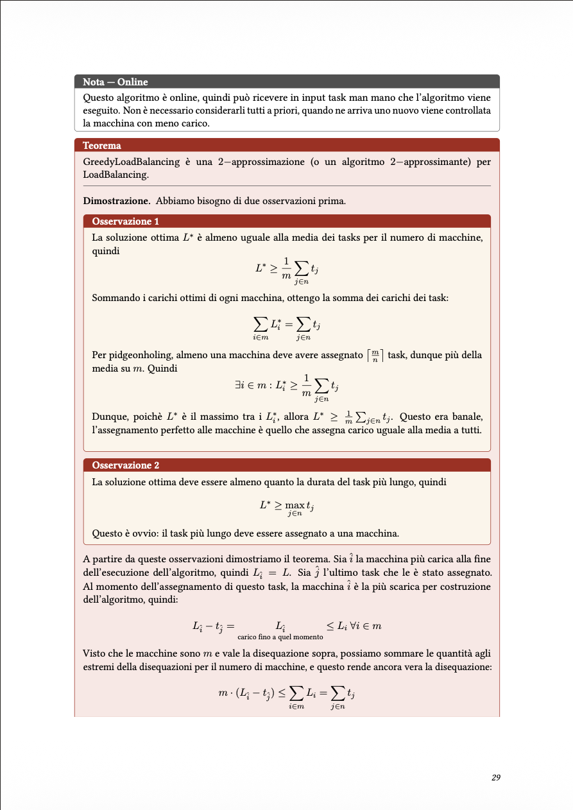
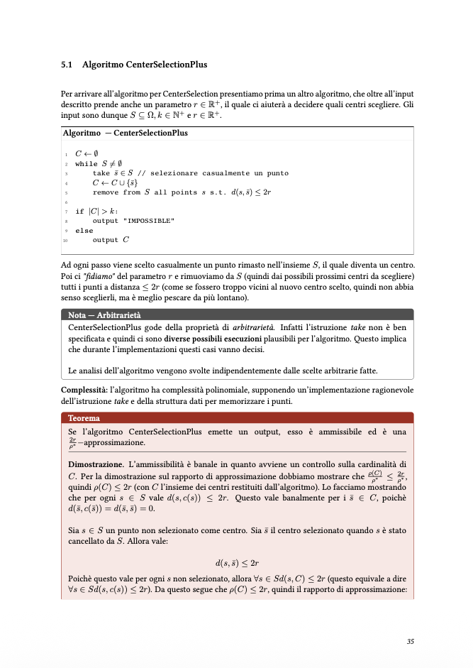
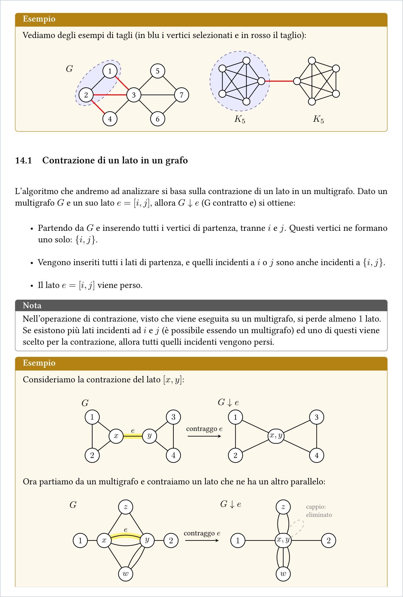
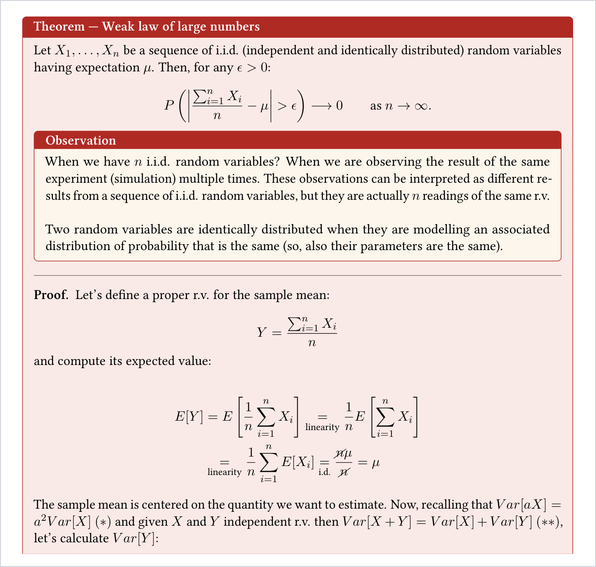
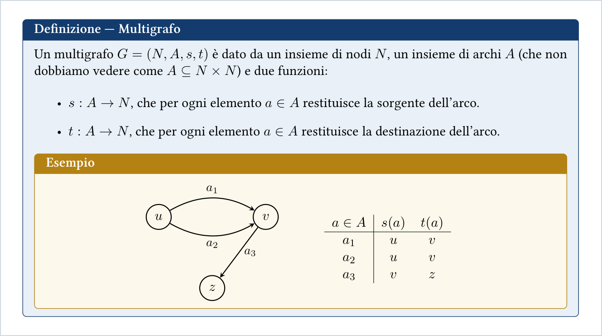
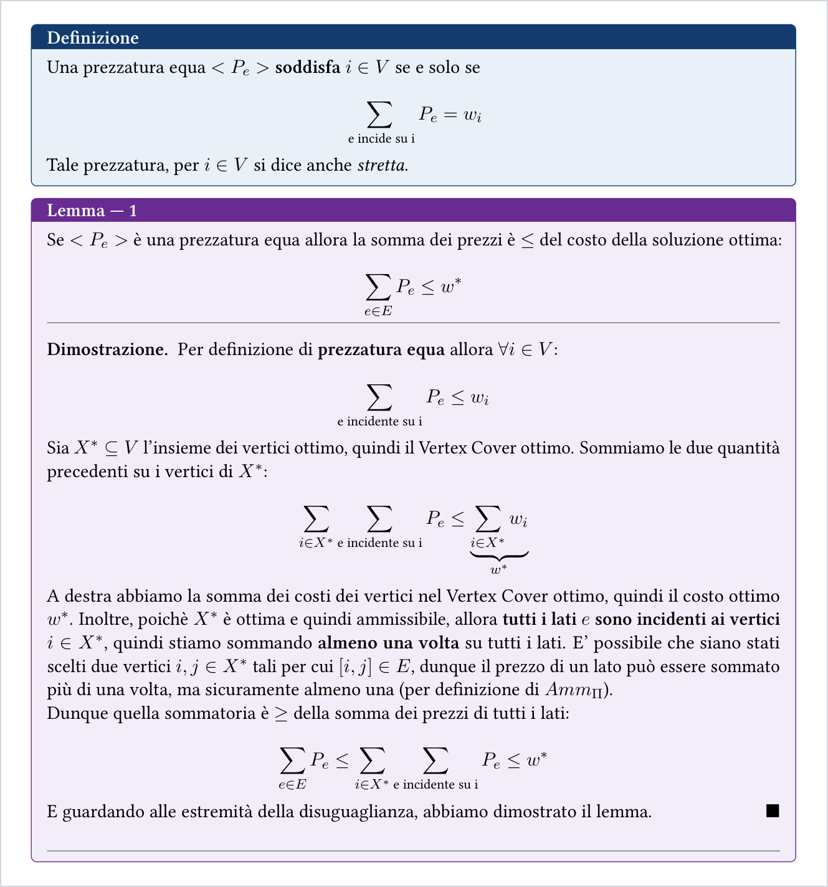
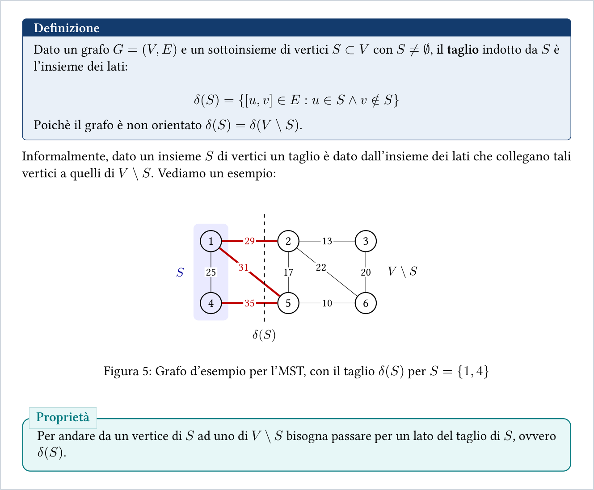
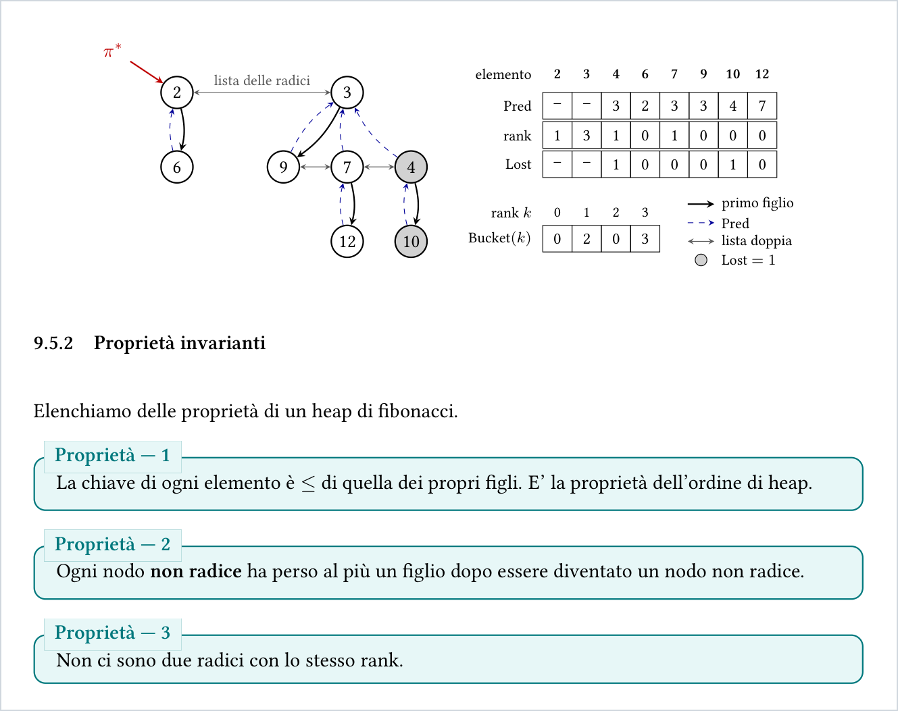
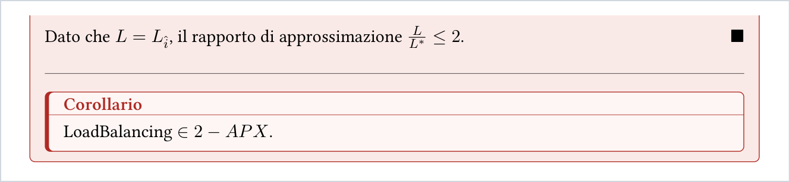

# LaTeX Notes Template

[](https://github.com/fedeRizzi04/latex-notes-template/actions/workflows/latex.yml)
[](https://www.latex-project.org/)
[](LICENSE)

A minimal LaTeX template for lecture/course notes (`notes.tex`, with shared settings in `notes.sty`), built with `scrbook` and supporting both Italian and English labels (switch via the package option: `\usepackage[italiano]{notes}` or `\usepackage[english]{notes}`).

Every environment can be written with its Italian or English name; the printed label always follows the language option:

| Italian | English |
|---|---|
| `definizione` | `definition` |
| `proprieta` | `property` |
| `teorema` | `theorem` |
| `lemma` | `lemma` |
| `corollario` | `corollary` |
| `esempio` | `example` |
| `nota` | `note` |
| `osservazione` | `observation`, `remark` |
| `evidenzia` | `highlight` |
| `algoritmo` | `algorithm` |

## How it works

On every push or pull request, the [`latex.yml`](.github/workflows/latex.yml) GitHub Action compiles `notes.tex` and publishes `notes.pdf` as a build artifact.

## Examples

Styled boxes for notes, theorems, proofs and algorithms — ready to use out of the box:

<p align="center">
  
  &nbsp;&nbsp;
  
</p>

### More examples

Every environment in action — definitions, lemmas, properties, examples, corollaries — together with TikZ figures and nested boxes:

<table>
  <tr>
    <td width="50%" valign="top">
      
      <p align="center"><sub><code>esempio</code> with TikZ graphs, <code>nota</code></sub></p>
      
      <p align="center"><sub><code>teorema</code> with nested <code>osservazione</code> and <code>proof</code> — English labels</sub></p>
      
      <p align="center"><sub><code>definizione</code> with a nested <code>esempio</code></sub></p>
    </td>
    <td width="50%" valign="top">
      
      <p align="center"><sub><code>definizione</code> and <code>lemma</code> with <code>proof</code></sub></p>
      
      <p align="center"><sub><code>definizione</code>, captioned figure, <code>proprieta</code></sub></p>
      
      <p align="center"><sub>Figure with tables, numbered <code>proprieta</code> boxes</sub></p>
      
      <p align="center"><sub><code>corollario</code> closing a <code>teorema</code></sub></p>
    </td>
  </tr>
</table>

## Adding new folders or files

The workflow only triggers on changes to specific paths:

```yaml
on:
  push:
    paths:
      - "notes.tex"
      - "notes.sty"
      - ".github/workflows/latex.yml"
```

If you add a new folder or file to the repo (e.g. `images/` for figures included in the document) that is relevant for the Latex compiler, **you must add that path to `latex.yml`** under both `push.paths` and `pull_request.paths`. Otherwise, changes to new files won't trigger a recompilation.

Example:

```yaml
on:
  push:
    paths:
      - "notes.tex"
      - "notes.sty"
      - "images/**"
      - ".github/workflows/latex.yml"
  pull_request:
    paths:
      - "notes.tex"
      - "notes.sty"
      - "images/**"
      - ".github/workflows/latex.yml"
```
